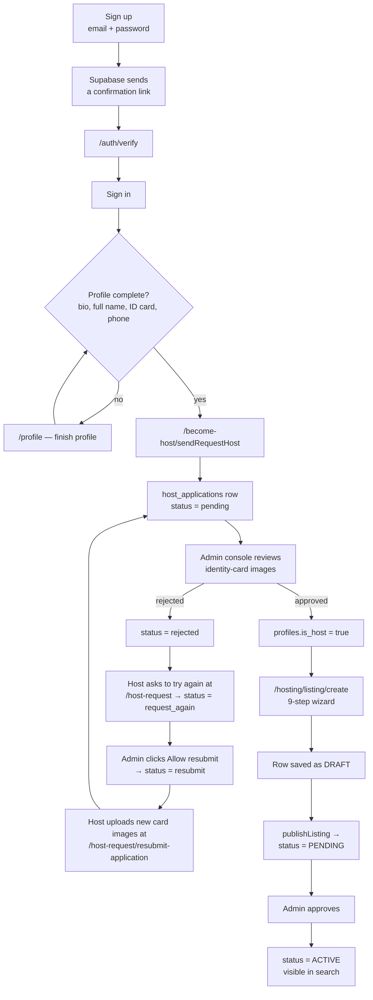
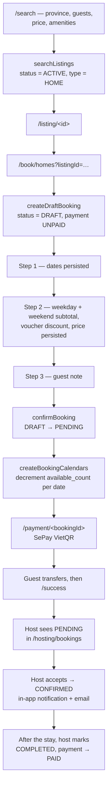
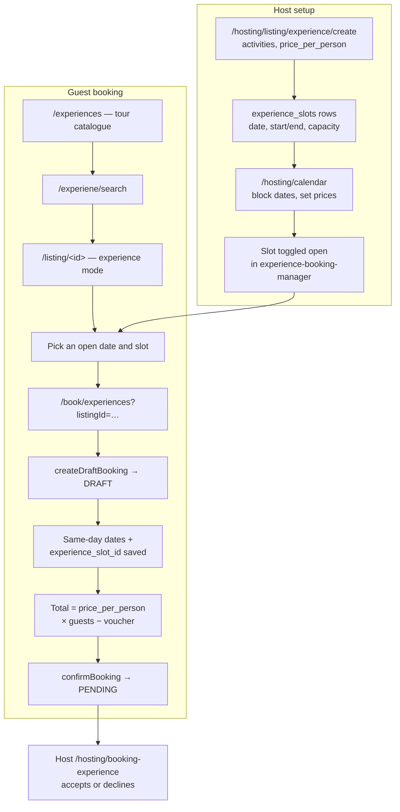

# Homestay Booking — Accommodation & Tour Experience Platform

> **Two marketplaces in one codebase: a guest books a homestay night or a guided tour slot, and the host runs the whole operation — listings, calendar, vouchers, bookings — from the same account.**

[]()
[]()
[]()
[]()
[]()

---

## At a Glance

|                          |                                                                                                                                                                                                                                                       |
| :----------------------- | :---------------------------------------------------------------------------------------------------------------------------------------------------------------------------------------------------------------------------------------------------- |
| **The problem**          | Booking a stay in Vietnam happens over Zalo and bank transfer screenshots. Availability lives in the host's head, deposits are unverifiable, and tours are sold by the same informal channels.                                                          |
| **Who has it**           | Two sides: **guests** planning a trip, and **hosts** who own a homestay or run a tour and want bookings without building a website.                                                                                                                   |
| **How it worked before** | Guest messages the host, asks whether a date is free, haggles, transfers a deposit, and sends a screenshot. The host keeps a paper calendar and confirms by hand.                                                                                       |
| **What this repo does**  | A guest-facing marketplace (search, listing detail, multi-step booking, VietQR payment, wishlist, reviews, chat) and a host console (listing wizard, per-date calendar, vouchers, cancellation policies, booking inbox, revenue reporting) in one app. |
| **Measured outcome**     | Every reservation becomes a row with a status, a price history, and a per-date inventory decrement — instead of a chat thread and a memory.                                                                                                            |
| **Scale**                | ~31,000 lines of TypeScript / TSX · 40 pages · 4 API route handlers · 117 service modules · 33 database tables · 239 commits · 8 contributors                                                                                                          |
| **Status**               | Academic course project (FPT University WDP), feature-complete on the booking and hosting flows. Payment is confirmed out-of-band — see [Roadmap](#roadmap)                                                                                             |

> **In one sentence:** it is a booking front-end for guests, and an operations console for the hosts who supply the inventory.

**Companion repo:** moderation (host applications, listing approval, bans, banners, user suspension) lives in a second deployable over the same Supabase project — [`homestay-booking-admin`](../homestay-booking-admin/README.md). This repo has no admin screens.

---

## The Problem

A small homestay in the Mekong Delta sells through Facebook posts and Zalo messages. The consequences are structural, not cosmetic:

- **Availability is not queryable.** Whether the 14th is free is a question only the host can answer, and only if they remember. Double-booking is discovered at check-in.
- **Two inventory models, one channel.** A homestay sells a *night*; a tour sells a *slot on a date*. Both are described in the same chat thread, and neither has a real record.
- **Deposits are unverifiable.** A transfer screenshot proves an amount moved, not which booking it paid for.
- **Seasonal pricing is manual.** Weekday and weekend rates differ, but applying them is arithmetic in the host's head.
- **Policies are verbal.** "Free cancellation 48 hours before" is a promise with no record of when the guest agreed to it.

For the guest the mirror problem: no way to compare, no way to know a listing is real, and no confirmation to point at later.

---

## The Solution

### For the guest

| Before                                     | With this platform                                                                 |
| :----------------------------------------- | :--------------------------------------------------------------------------------- |
| Message the host, wait, hope               | Filter by province, guest count, price range, and amenities                        |
| Ask "how much for 3 nights?"               | Weekday and weekend rates in the listing, subtotal computed per selected date      |
| Screenshot the transfer                    | SePay VietQR with the booking id in the transfer description                       |
| Paper promise about cancellation           | Cancellation policy stored per listing and shown before the guest commits          |
| Forgot which listing was saved             | Wishlist, persisted per account                                                    |
| No proof of the stay                       | Booking history with status, price, and a review the host can respond to           |

### For the host

| Before                        | With this platform                                                                       |
| :---------------------------- | :--------------------------------------------------------------------------------------- |
| Describe the place in a post  | A 9-step listing wizard: basic info, location, amenities, rules, pricing, images, publish |
| Keep availability in a diary  | A per-date calendar: block dates, see the weekday / weekend price and a status dot per day |
| Split the deposit by hand     | A booking inbox filtered by status: PENDING → CONFIRMED → COMPLETED → CANCELLED          |
| Say "10% off this week"       | Per-listing vouchers with a code, minimum spend, and a usage counter                      |
| Tell guests "free cancel 48h" | A named cancellation policy with a refund percentage and an hour window                  |
| Guess the month's revenue     | Revenue services aggregating by week, month, and year                                    |

### For the platform

One Supabase project, one identity model. `profiles.role` separates `USER` from `ADMIN`; `profiles.is_host` is the second gate. The UI is almost entirely client components calling typed service modules — there is no custom server in between.

---

## Who Uses It

| Role          | How they get it                             | What they can do                                                                                                     |
| :------------ | :------------------------------------------ | :------------------------------------------------------------------------------------------------------------------- |
| **Guest**     | Sign up with email + password               | Search, view, wishlist, book a home or an experience, pay, cancel, review, message a host                          |
| **Host**      | `profiles.is_host = true`, granted by admin | Everything a guest can do, plus the `/hosting/*` console: listings, calendar, vouchers, policies, bookings, revenue |
| **Admin**     | `profiles.role = "ADMIN"`                   | No screens in this repo — operates the companion admin console                                                       |

`is_host` is not self-service. A guest submits an application with two identity-card images and waits.

---

## Core Workflows

### 1. Guest → host → published listing



The wizard writes the listing row early and fills it in step by step, so an abandoned wizard leaves a `DRAFT` nobody sees, not a half-published listing.

### 2. Booking a home



A `DRAFT` is reused rather than recreated: if the same guest reopens the booking page for the same listing, `createDraftBooking` returns the existing draft. Abandoned drafts never hold inventory, because calendar rows are only written at confirmation.

### 3. Booking a tour, and the host's calendar



An experience has no range — `check_in_date` and `check_out_date` are the same day, and the slot id is what actually reserves capacity.

---

## Key Business Rules

These are the rules a reviewer should check first. Each one is enforced in a service or a query, not only written down here.

| Rule      | Domain      | What is enforced                                                                                                                                                                                                                                                                              |
| :-------- | :---------- | :---------------------------------------------------------------------------------------------------------------------------------------------------------------------------------------------------------------------------------------------------------------------------------------------- |
| **BR-01** | Listing     | Only `status = ACTIVE` listings reach the marketplace; `searchListings` also pins `listing_type = HOME`                                                                                                                                                                                        |
| **BR-02** | Listing     | A host "publishes" into `PENDING`, never `ACTIVE` — activation is an admin action in the companion console                                                                                                                                                                                    |
| **BR-03** | Listing     | The host edit screen at `/hosting/listing/edit/<id>` uses `role === "USER" && is_host`, or `role === "ADMIN"`, to decide whether to render the edit form or a read-only view. The listing *index* computes the same flag but never reads it                                                     |
| **BR-04** | Booking     | A booking starts as `DRAFT` with `payment_status = UNPAID`; a second draft for the same guest + listing is reused                                                                                                                                                                             |
| **BR-05** | Booking     | `confirmBooking` updates only where `id = … AND user_id = caller AND status = DRAFT`; anything else matches zero rows                                                                                                                                                                          |
| **BR-06** | Booking     | Guests may cancel only `PENDING` bookings; `cancelBooking` throws on every other status                                                                                                                                                                                                        |
| **BR-07** | Inventory   | Each booking date must have `available_count > 0` and `is_block = false`, otherwise `createBookingCalendars` throws; the check-out date is not consumed                                                                                                                                        |
| **BR-08** | Inventory   | A new calendar row starts at `max_guests − 1` and is priced `price_weekend` or `price_weekday` depending on the date's weekday                                                                                                                                                                  |
| **BR-09** | Calendar    | Host blocking sets `is_block = true` on every date in the range, updating existing rows and inserting the missing ones with `available_count = home.quantity`                                                                                                                                   |
| **BR-10** | Host        | Applying to host requires a complete profile — `bio`, `full_name`, `identity_card`, `phone` — before the form renders                                                                                                                                                                          |
| **BR-11** | Host        | `sendBecomeHostRequest` refuses to write while the application is `pending`, `approved`, `rejected`, or `request_again`; only after an admin moves it to `resubmit` does the upsert run and set it back to `pending`                                                                             |
| **BR-12** | Pricing     | The voucher discount is a flat `discount_value` subtracted from the subtotal and floored at zero; `min_price` gates eligibility                                                                                                                                                                |
| **BR-13** | Pricing     | The total is computed in the browser and written onto the booking (`updateBookingTotalPrice`) before confirmation — the booking row, not the listing, is the price of record                                                                                                                    |
| **BR-14** | Pricing     | `calendar.price` is written only when a row is first created; there is no path that updates it later, so a listing's rate change never reaches dates already in the calendar                                                                                                                    |
| **BR-15** | Experience  | An experience booking is a single date plus `experience_slot_id`; both date columns hold the same day                                                                                                                                                                                          |
| **BR-16** | Experience  | Remaining seats are computed at read time as `max_attendees − sum(total_guests)` over bookings that are neither `CANCELLED` nor `DRAFT`; a slot with zero seats is not pre-selected                                                                                                             |
| **BR-17** | Payment     | A booking becomes `PAID` when the host marks it `COMPLETED`; the VietQR amount is `total_price × 25000`, with `BK<bookingId>` as the transfer description                                                                                                                                      |
| **BR-18** | Search      | Blocked or zero-availability listings are dropped from results only when at least one filter is active; otherwise they are returned flagged `is_bookable: false`. The check reads **every** calendar row for the listing, not the requested dates — so it is "this listing has some blocked or sold-out date", not a booking-date check |

> `vouchers` also stores `max_discount`, `usage_limit`, and `used_count`. They are editable in the host console and shown in the voucher list, but checkout applies only `discount_value` and `min_price` — the cap and the usage counter are not enforced yet ([Roadmap](#roadmap)).

---

## Architecture & Tech Stack

**Stack:** Next.js 16.1 (App Router) · React 19.2 · TypeScript 5 · Tailwind CSS 4 · Supabase (PostgreSQL + Auth + Storage) · Radix UI · Recharts · Embla Carousel · jsPDF · Nodemailer · SePay VietQR

### Client-to-database, no custom backend

```
Page / Component        app/**/page.tsx · src/components/**
      │  imports
      ▼
Service module          src/services/<domain>/<verb><Noun>.ts     typed, throws on error
      │  supabase-js
      ▼
Supabase                anon key + Row Level Security
      │
      ▼
PostgreSQL              profiles · listings · homes · experiences
                        bookings · calendar · experience_slots · vouchers
```

There is no API layer for data. `src/lib/supabase.ts` is a single anon-key client instantiated once and imported everywhere; authorization is the session attached to that client plus whatever RLS policies are configured on the project. The four route handlers under `app/api/` exist only because they need `nodemailer`, which cannot run in the browser.

| Layer           | Where                                          | Contains                                                                 |
| :-------------- | :--------------------------------------------- | :----------------------------------------------------------------------- |
| Pages           | `app/**/page.tsx`                              | 40 routes — 34 `"use client"`, 6 server-rendered shells                 |
| Components      | `src/components/**` + `components/ui`          | 100 components — 82 feature, 17 shadcn primitives, 1 loose link component |
| Services        | `src/services/**`                              | 117 modules, one verb per file — `get`, `create`, `update`, `save`, `publish` |
| Types           | `src/types/**`                                 | 30 files mirroring the tables, plus `enums.ts` for every status union     |
| Server handlers | `app/api/**/route.ts`                          | 4 handlers: new booking, confirm, cancel, review alert — three send mail, the cancel one also flips the booking |

### Domain model, abbreviated

```
profiles ──1:1── auth.users
   │  role: USER | ADMIN          is_host: boolean
   │
   ├──< listings ──1:1── homes        (max_guests, bed/bath, weekday + weekend price)
   │        │      └──1:1── experiences (price_per_person, duration, activities)
   │        ├──< listing_images            storage bucket: listing_images
   │        ├──< listing_amenities >── amenities
   │        ├──< listing_rules     >── rules
   │        ├──< vouchers
   │        ├──< cancel_policy
   │        ├──< calendar           (listing_id, date, available_count, is_block, price)
   │        ├──< experience_slots   (experience_id, start/end time, max_attendees)
   │        └──< reviews ──< responses
   │
   └──< bookings (status, payment_status, dates, experience_slot_id, total_price)
            └──< booking_logs
```

### Session model

- **Sign-up** — email + password, with a disposable-domain check and a strength check in `src/utils/validation.ts`; Supabase sends the confirmation mail.
- **Sign-in** — `loginUser` also verifies that a `profiles` row still exists, and signs the session out if it does not, so a deleted account cannot hold a live session.
- **Host gate** — `is_host` on the profile, set only by the admin console when an application is approved.
- **Admin gate** — `role = "ADMIN"`. This repo only reads it, to let an admin open the host screens; the admin console in the companion repo is the only place that *writes* on it.

---

## Project Scale

| Metric                          | Value                                                                              |
| :------------------------------ | :--------------------------------------------------------------------------------- |
| Source lines (TypeScript / TSX) | 30,948                                                                             |
| App Router pages                | 40                                                                                 |
| API route handlers              | 4 — three send email, `cancel-booking` also cancels the booking                    |
| Components                      | 100 total — 82 feature components, 17 UI primitives, 1 link helper                  |
| Service modules                 | 117                                                                                |
| Domain type files               | 30                                                                                 |
| Database tables                 | 33                                                                                 |
| Storage buckets                 | 5 — `listing_images`, `identity-cards`, `chat-images`, `avatars`, `avatar`         |
| Commits                         | 239 across 69 branches (24 local, 45 remote)                                        |
| Contributors                    | 8 people, 9 git identities                                                         |
| Tracked files                   | 335                                                                                |
| History                         | 2026-01-13 → 2026-03-27                                                            |
| Largest file                    | `app/listing/[id]/page.tsx` — 878 lines                                            |

---

## Getting Started

### Prerequisites

- Node.js 20+
- A Supabase project with the schema above, plus the Storage buckets `listing_images`, `identity-cards`, `chat-images`, and `avatars`
- A Gmail account with an app password (booking confirmation emails)
- A SePay merchant account, if you want the VietQR image to resolve to a real bank

### Install and run

```bash
git clone <homestay-booking-repo>
cd homestay-booking
npm install
```

Create `.env.local` in the project root:

| Variable                         | Required | Purpose                                                                     |
| :------------------------------- | :------: | :-------------------------------------------------------------------------- |
| `NEXT_PUBLIC_SUPABASE_URL`       |    ✅    | Supabase project URL — read by `src/lib/supabase.ts`                        |
| `NEXT_PUBLIC_SUPABASE_ANON_KEY`  |    ✅    | Anon / publishable key. Safe **only** if RLS is enabled on every table      |
| `EMAIL_USER`                     |    ✅    | Gmail address used as the SMTP user and as the `From` header                |
| `EMAIL_PASS`                     |    ✅    | Gmail app password — a normal password will be rejected on port 465/587     |
| `NEXT_PUBLIC_RESEND_API_KEY`     |    ⚠️    | Referenced once, in a `console.log` in `app/profile/page.tsx`; not used for sending |

```bash
npm run dev      # http://localhost:3000
npm run build    # production build
npm run lint     # ESLint 9
```

> There is **no `.env.example`** in the repository. The table above is reconstructed from every `process.env.*` reference in the source.

> **Demo data:** the app needs a seeded Supabase instance — provinces, districts, wards, amenities, rules, and at least one `ADMIN` profile. No seed script is included. Catalogue tables (`provinces`, `districts`, `wards`) follow the Vietnamese administrative codes.

> **Image hosts.** `next/image` only loads remote images from hostnames listed under `images.remotePatterns` in `next.config.ts`. A fresh clone ships that list empty, so the two `next/image` call sites (the host calendar and the listing publish preview) fail to render Supabase URLs until you add your own `<project-ref>.supabase.co` entry. Other images in the app go through plain ``.

---

## Project Structure

```
homestay-booking/
├── app/
│   ├── page.tsx                     Landing: hero, latest, most booked, top rated
│   ├── search/                      Filtered home search (provinces, guests, price, amenities)
│   ├── listing/[id]/                Listing detail — home or experience
│   ├── book/
│   │   ├── homes/                  3-step booking wizard
│   │   └── experiences/            Date + slot booking wizard
│   ├── payment/[bookingId]/        VietQR payment, plus /success
│   ├── bookings/                   Guest booking history, with a jsPDF invoice download
│   ├── wishlist/                   Saved listings
│   ├── profile/                    Profile, avatar, password
│   ├── auth/                       Login, verify, forgot / reset password
│   ├── become-host/                Application form, pending state, verify
│   ├── host-request/               Rejected application + resubmission
│   ├── hosting/
│   │   ├── listing/                Create / edit / my listings, experience variants
│   │   ├── calendar/               Month grid: block dates, price + status per day
│   │   ├── bookings/               Home booking inbox with status actions
│   │   ├── booking-experience/     Tour bookings
│   │   ├── experience-booking-manager/
│   │   └── policies/               Cancellation policies
│   ├── experiences/                Tour catalogue (Embla carousel)
│   ├── experiene/                  Tour search (legacy spelling, kept in routes)
│   ├── experience-listings/        Alternate tour list route
│   ├── most-booked-listings/ · top-rated-listings/
│   └── api/                        4 route handlers: new / confirm / cancel booking, review alert
├── components/ui/                  shadcn primitives
├── src/
│   ├── components/                 82 feature components, grouped by domain
│   ├── services/                   117 service modules
│   ├── types/                      30 type files + enums.ts
│   ├── context/ · hooks/ · utils/
│   ├── data/                       Static catalogues
│   └── lib/supabase.ts             The single Supabase client
└── public/
```

---

## Development Conventions

### Branching and commits

Never push to `main` or `dev` directly.

```bash
git checkout dev && git pull origin dev
git checkout -b feature/booking-flow
git add .
git commit -m "feat(booking): persist weekend pricing on confirmation"
git push origin feature/booking-flow
```

Conventional Commits: `feat`, `fix`, `refactor`, `docs`, `chore`. Pull requests target `dev` and merge only after review.

### Where code goes

- **A database call belongs in `src/services/`**, one exported verb per file, `throw`ing on error so the page can `toast` it.
- **A page owns page state**; a component under `src/components/<domain>/` owns one piece of UI.
- **A new status value goes in `src/types/enums.ts` first** — the unions there are what the rest of the code narrows on.
- **`app/` keeps its legacy route spellings** (`experiene`, `host-request`). Renaming them is a routing change, not a tidy-up.

---

## Testing & Quality

**Automated tests: none.** There is no test runner, no test file, and no CI workflow in the repository. This is a real gap rather than an omission from this document.

What does exist:

- **Linting** — ESLint 9 with `eslint-config-next`, run via `npm run lint`. It is the only automated check.
- **Type checking** — `tsc` through `next build`. Status unions in `src/types/enums.ts` catch most status-handling mistakes at compile time.
- **Guard rails in the data layer** — `confirmBooking` scopes its update by `user_id` and `status = DRAFT`; `createBookingCalendars` throws instead of over-booking; `cancelBooking` throws on any status but `PENDING`. These are the rules that would otherwise need tests the most, and they are written so a wrong call fails loudly.
- **Manual walkthrough** — the three workflows in [Core Workflows](#core-workflows) are the path used at the course defence, in the order it is presented.

---

## Roadmap

Shipped:

- [x] Email + password auth with verification, password reset, and a deleted-account guard on sign-in
- [x] Home search: province, guest count, price range, amenity set, multi-key sort
- [x] Listing detail with host card, rules, amenities, cancellation policy, reviews, host responses
- [x] 9-step listing wizard for homes, and a parallel wizard for experiences
- [x] Multi-step booking that persists each step onto a `DRAFT` before confirming
- [x] Per-date calendar inventory with `available_count` and `is_block`
- [x] Host console: listings, calendar, bookings inbox, vouchers, policies, revenue by week / month / year
- [x] Tour experiences with slots, activities, and a separate booking manager
- [x] Wishlist, in-app notifications, guest ↔ host chat, reviews with host responses
- [x] SePay VietQR payment page with the booking id as the transfer reference
- [x] Host revenue chart (Recharts) and a client-side jsPDF invoice download from the booking history

Not yet built:

- [ ] **Automatic payment reconciliation.** `app/payment/[bookingId]/success` is a UI simulation; there is no webhook handler in this repo, so `payment_status` only changes when a host marks a booking `COMPLETED`
- [ ] **Date-aware search.** `checkIn` and `checkOut` reach `searchListings` and then hit an empty `if (checkIn && checkOut) { … }` block, so the parameters are accepted but no date predicate is applied. Availability is reflected only through the listing-level `is_bookable` flag
- [ ] **Server-side price authority.** The total is computed in the browser and then written by the browser; a server function should recompute it from listing dates, voucher, and fees
- [ ] **Voucher limits.** `max_discount`, `usage_limit`, and `used_count` are stored but never enforced, and `used_count` is never incremented
- [ ] **Automatic refunds.** `cancelled_reasons` and `cancel_policy` are recorded, but no refund path moves money back
- [ ] **Atomic confirmation.** `handleConfirm` sets the booking to `PENDING` and then decrements the calendar in a loop; if a later date throws, earlier decrements have already been written and the booking is already confirmed. Both steps belong in one Postgres function
- [ ] **Slot capacity at write time.** Seats are computed when the page loads, not enforced when the booking is confirmed, so two guests booking the last seats at the same moment can both succeed
- [ ] **One-way date blocking.** `blockDates` only ever writes `is_block: true`; there is no unblock action in the host calendar, so a mistakenly blocked date has to be cleared in the database
- [ ] **Calendar price is display-only.** The month view shows the weekday / weekend price from `homes`, but there is no control to override the price for a specific date, even though `calendar.price` exists
- [ ] **Metadata and identity.** `app/layout.tsx` still carries the create-next-app title and description
- [ ] **Host gating is partial.** Only the edit screen branches on `is_host`. The other `/hosting/*` pages load `getHostListings(user.id)`, which filters by `host_id` and returns an empty list for a non-host rather than redirecting — so access is scoped by data, not by a gate
- [ ] **Automated tests and CI** — Vitest for the booking and calendar services, Playwright for the two booking wizards

---

## Team

| Contributor           | Commits | Focus                                                              |
| :-------------------- | ------: | :----------------------------------------------------------------- |
| Hau Nguyen (`hau0909`) |     93 | Team lead, architecture, booking engine, host console              |
| `jooyoung`            |     43 | Listings, experiences, hosting flows                               |
| `jooyoung_coding`     |     26 | Hosting and experience management                                  |
| `hoang240`            |     22 | Search, listing detail, payment                                    |
| `TrietCMCE180982`     |     19 | Wishlist, reviews, notifications                                   |
| `loclon`              |     18 | UI, calendar, shared components                                    |
| `ChauTriet`           |     12 | Profile, auth                                                      |
| `Tlo6903`             |      6 | Bug fixes and UI polish                                            |

Commit counts are from `git shortlog -sn --all`; two author names per person appear where the machine's git identity changed mid-project.

---

## License

Academic course project, FPT University. Not licensed for commercial use.
